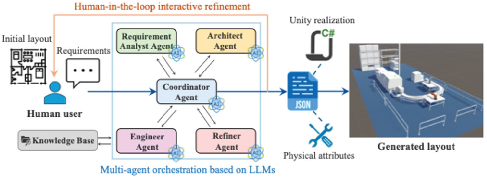
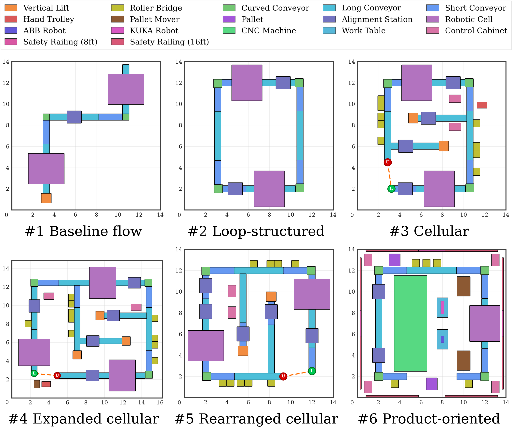

# LLM4RMS - LLM Agents-Driven Layout Generation for Reconfigurable Manufacturing Systems

Code for the CIRP Annals 2026 paper *LLM Agents-Driven Layout Generation for Reconfigurable Manufacturing Systems* (see [Citation](#citation)).



LLM4RMS generates shop-floor layouts for reconfigurable manufacturing systems from requirements written in natural language. In the framework, a coordinator agent orchestrates a requirement analyst, an architect, an engineer, and a refiner agent. The agents draw on a knowledge base of equipment and spatial priors, and the resulting layout is exported as JSON and realized in Unity.

## How it works

This repository contains the core generation loop:

1. The requirement analyst agent splits the requirement into process stages and selects equipment for each stage from the equipment catalog.
2. The architect agent turns the plan into a scene graph: the equipment instances, the material flow between them, and pairs of equipment that should stand next to each other.
3. The scene graph is checked for unknown equipment types, duplicate ids, and edges that point to missing objects. Any problems go back to the architect, which returns a corrected scene graph (at most two rounds).
4. The equipment is placed in rows along the material flow, with clearances between machines and aisles between rows. Consecutive rows run in opposite directions, so the flow continues where the previous row ended.
5. The layout is saved as JSON and plotted in 2D.

## Results in the paper



Layouts generated in the paper for six scenarios, from a baseline flow line to a product-oriented cell.

## Installation

Python 3.9 or later.

```bash
pip install -r requirements.txt
```

## Usage

Place and plot the example scene graph without calling an LLM:

```bash
python run_example.py --scene examples/assembly_cell.json
```

Generate a layout from a requirement:

```bash
export OPENAI_API_KEY=...
python run_example.py \
    --requirement "Machine aluminium housings on two CNC machines, assemble them with a cover, inspect them and pack them for shipping." \
    --length 24 --width 14
```

Any OpenAI-compatible endpoint works: set `OPENAI_BASE_URL` and pass the model name with `--model`. The results are written to `output/layout.json` and `output/layout.png`.

Run the tests:

```bash
python -m pytest
```

## Repository layout

```
llm4rms/catalog.py       Equipment catalog
llm4rms/agents.py        Requirement analyst and architect agents, check-and-repair loop
llm4rms/scene_graph.py   Scene graph format and validation
llm4rms/placement.py     Row-based placement along the material flow
llm4rms/visualize.py     2D plot
llm4rms/llm.py           Client for OpenAI-compatible chat APIs
run_example.py           Command-line entry point
examples/                Example scene graph
docs/                    Figures from the paper
tests/                   Unit tests (no API calls)
```

## Notes

The equipment catalog holds twelve generic equipment types with rounded footprints, and equipment keeps its catalog orientation during placement. The engineer and refiner agents, the knowledge base, and the Unity realization described in the paper are not part of this repository.

## Acknowledgements

The agent-based scene graph approach builds on I-Design (Çelen et al., 2024, [arXiv:2404.02838](https://arxiv.org/abs/2404.02838)).

## License

The code is released under the MIT License. See [LICENSE](LICENSE). The figures in `docs/` are taken from the paper, which is published open access under [CC BY 4.0](https://creativecommons.org/licenses/by/4.0/).

## Citation

If you use LLM4RMS in your research, please cite:

```bibtex
@article{llm4rms2026,
  title={LLM Agents-Driven Layout Generation for Reconfigurable Manufacturing Systems},
  author={Wang, Tianyu and Liu, Zhihao and Wang, Xi Vincent and Wang, Lihui},
  journal={CIRP Annals},
  year={2026},
  institution={KTH Royal Institute of Technology}
}
```
